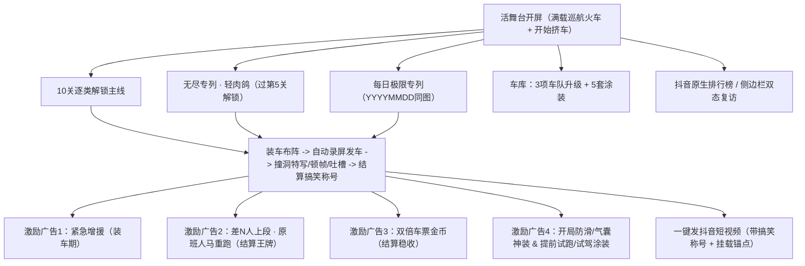

# 《超载快车》抖音小游戏 · 最终版执行计划文档（V3 · 高留存首发版）

> [!IMPORTANT]
> **已锁定核心产品定位**：**坚定横屏 · 纯中文 · 纯 IAA（无内购/免版号）· 高留存首发版（黄金平衡）**。
> 保持 **纯 Canvas2D 零依赖架构** 与 **< 220 KB 秒开主包**，兼顾 **首局 3 秒钩子、10 关阶梯教学、手残车队养成保底、硬核轻量无尽肉鸽、短视频爆点传播、抖音一次性过审合规** 六大目标。

---

## 一、最终产品架构与核心模块总览



---

## 二、已锁定的 6 大核心设计定稿

### 1. 角色真实机制差异升级（5 核心 + 1 后期彩蛋）
| 角色 | 解锁节点 | 物理与机制核心 | 视觉反馈强化 |
|---|---|---|---|
| **瘦猴** | 第 1 关 | 轻（0.62）、矮、摩擦低（0.40）、数量最多，主力填缝冲分 | 惊恐/大笑表情动画 |
| **胖叔** | 第 2 关 | 重（3.5）、摩擦 0.94、被抓提供 **1.48x 托肩稳固加成** | 抓胖叔连线显示为**金色粗稳固绳**；落地肚腩抖动+微震屏 |
| **挂壁娃** | 第 3 关 | 唯一 `sideCling` 直挂车门扶手、**完全免疫低矮涵洞削顶** | 选中时左右车门扶手脉冲绿光高亮 |
| **竹竿** | 第 4 关 | 长臂跨堆拉索（手长 84、3 抓点）、**缩头下压 65%** 更耐过洞 | 双抓连线渲染为醒目的**紫色跨堆弹性拉索** |
| **大妈（重做·方案A）** | 第 5 关 | **菜篮兜底安全网**：展开双侧巨型菜篮，上方滑落的轻量乘客（瘦猴/挂壁娃/VIP）进入菜篮捕捉区会自动**兜住锁死**，专防高层崩塌！ | 双侧超大编织菜篮绘制 + 兜住瞬间弹出「兜住啦！」金圈反馈 |
| **VIP 老板（彩蛋）** | 第 7 关 | **1 人顶 3 人计分**，金光公文包，体滑摩擦低，极难保住 | 头顶金色 `VIP×3` 徽章；摔飞触发全屏惋惜吐槽弹幕 |

### 2. 10 关逐类解锁曲线与克制「弱指引」设计（数据驱动 `src/levels.js`）
- **极简秒进开屏**：干净微动火车主视觉（车头轻冒白烟）+ 标题 +「开始挤车」大按钮（外加选站/车库/排行小入口），**不播开屏示范动画**，点即进关零耗时。
- **第 1 关一次性站长简短对话框（仅首局弹出，点击即关）**：用幽默口吻 2 句话讲清背景（早高峰车厢爆满，车外全员等车）与核心操作（点车顶叠人 → 点发车 → 遇低桥按住缩头），之后永不再弹。
- **不剧透、留探索空间的弱指引（仅前 5 关 + 第 7 关）**：
  - **无预连线蜘蛛网、无装车限高剧透尺、无预摆样本、无强制慢动作锁屏**；所有物理特效（胖叔金绳、竹竿紫索、大妈菜篮兜人）均在**落手后自然触发**，保留玩家自主摸索与试错的发现感。
  - **第 1 关（新手起步）**：仅瘦猴（25人），1 座高桥 + 缓刹；车上 0 人时车顶淡字水印 `点击车顶放人`（放 1 人即消失）；达 B 级后「发车」轻呼吸；首次过桥前右下缩头键轻闪 2 下（不降速不打断）。
  - **第 2 关（猛刹考验）**：解锁 **胖叔**（32人），底部新卡上方浮现 2.5 秒非阻断小提示条（`新乘客【胖叔】：超重防滑，适合垫底`）。
  - **第 3 关（超低涵洞）**：解锁 **挂壁娃** + **撤回**（40人），小提示条（`新乘客【挂壁娃】：能直接挂在车门上`）+ 车门柔闪 2 秒微光，首次出现超低矮涵洞。
  - **第 4 关（颠簸双洞）**：解锁 **竹竿** + **`×3` 齐扑**（48人），小提示条（`新乘客【竹竿】：手超长，能拉住周围人`），连续起伏铁轨 + 双涵洞。
  - **第 5 关（全员集结）**：解锁 **大妈（菜篮兜底网）** + **`×5` 与混编**（55人），小提示条（`新乘客【大妈】：双菜篮能兜住掉下的人`）；通关 B 级解锁 **无尽专列模式**。
  - **第 6 关起**：**完全零提示**（仅第 7 关 VIP 老板登场给一次 2.5 秒小提示条），彻底交还玩家自由探索：
    - 第 6 关（阵风来袭，62人 + 迎面强阵风区）
    - 第 7 关（贵宾急停，68人 + VIP 老板 + 中途信号灯急停）
    - 第 8 关（狂风低桥，74人，阵风 + 低涵洞组合）
    - 第 9 关（极限三连，80人，三连超低涵洞 + 中途急停）
    - 第 10 关（春运地狱特快，90人，全机制满配终极奇观）
- **解锁规则**：达 **B 级** 即解锁下一关；未解锁关卡支持看 1 次激励视频「提前试跑」。

### 3. 中长线留存双引擎（轻度养成 + 轻量肉鸽）
- **车票金币与 3 项克制车队升级（`src/progress.js`）**：
  - 每局结算按运达人数发车票（翻车也有保底安慰车票），结算提供 **「看视频双倍领车票」**；
  - 3 项车库升级（每项 5 级，封顶增幅克制在 `+20%~25%`，绝不破坏物理翻车乐趣）：
    1. **车顶防滑漆**：提升全员车顶静态摩擦；
    2. **铁轨减震弹簧**：降低颠簸加速度峰值；
    3. **全员能量水壶**：提升缩头紧抓体力上限与恢复速度。
- **轻量无尽专列 · 物理肉鸽（过第 5 关解锁）**：
  - 不改车体刚体结构，100% 物理安全！每到一站**保留车上存活乘客**、按站数递增难度并补充新候车池；
  - 每站间弹出 **三选一强化词条**（共 8 个高爽感安全词条）：
    1. `502 强力胶`（全员抓力 +30%）
    2. `巨无霸菜篮`（大妈兜人范围 +40%）
    3. `铁鞋胖叔`（胖叔抓地焊死车顶）
    4. `冰镇功能饮料`（下站缩头不耗体力）
    5. `门外加塞`（立即空降 5 名挂壁娃）
    6. `风平浪静`（下站免疫阵风）
    7. `竹竿钢筋`（竹竿拉索承受力翻倍）
    8. `豪车贵宾`（空降 2 名 `×3` 计分 VIP 老板）
- **每日极限专列 + 5 套纯 Canvas 涂装**：
  - `YYYYMMDD` 确定性每日主题挑战局（如全员胖叔局、竹竿森林局、三连低洞局）；
  - 5 套涂装（经典红黄特快、复古绿皮快车、熊猫竹影专列、黄金土豪号、赛博霓虹号）按累计运人解锁，支持看广告单局试驾。

### 4. 短视频观感补强（针对横屏进抖音竖屏信息流痛点）
- **撞洞镜头特写 + 微顿帧**：撞上涵洞或单帧多人甩飞时触发 **0.12s 戏剧微顿帧** + **1.18x 动态拉近特写镜头**（持续 0.7s 平滑回弹），让竖屏刷到横屏录屏的观众一眼看清撞飞惨状！
- **夸张大字吐槽弹幕**：画布上方弹出高对比描边大字（如「胖叔稳如泰山！」「大妈菜篮神级兜底！」「竹竿惨遭剃光头！」「VIP老板飞啦！！！」），竖屏刷视频无需放大即可读清。
- **喜剧表情动画**：火车头超重冒汗喘气、急刹瞪大双眼；乘客在急刹/撞洞时统一切换惊恐 `O` 型嘴。
- **搞笑结算称号**：按本局物理表现自动生成称号印在结算卡与抖音分享文案中（如「牛顿棺材板焊死大师」「车顶剃光头·门外全苟活」「大妈菜篮收割机」「早高峰天女散花发射器」）。

### 5. 抖音全合规、真全屏适配与漏斗埋点
- **真全屏 0 黑边**：天空、云层、远山、铁轨向 `[-padX, VW + padX]` 无缝延展，16:9 / 19.5:9 / 21:9 全机型 0 黑边；交互控件按 `safeArea` 左右贴边，顶栏折叠为「当前站名 ▾」抽屉按钮，严格避让右上角抖音胶囊。
- **纯 Canvas 矢量图标库（`src/icons.js`）**：全面替换 Canvas 内 Emoji，消除安卓/iOS 字体宽度漂移与方块 `□`。
- **提审合规必过项**：
  - 左下 `8+` 适龄图标**可点击弹出完整《适龄提示说明》弹窗**；
  - **双态侧边栏复访弹窗**（普通进入弹引导卡 + `navigateToScene`，绝不直接发奖；侧边栏进入才发当日福利）；
  - 录屏支持切后台 `pause / resume`，结算页异步监听 `onStop` 动态点亮视频分享按钮；
  - 播激励视频前暂停游戏并静音，关闭回调后恢复；正式包配置 `DEV_MOCK_AD: false`；
  - 接入 `tt.getImRankList` 原生排行榜弹窗与 `tt.reportAnalytics` 6 大漏斗埋点。

---

## 三、工程目录规划（`overload-express-tt/`）

```text
overload-express-tt/
├── game.json               # 横屏配置（landscape）
├── project.config.json     # 字节开发者工具配置（packOptions 排除本地工具）
├── game.js                 # 主入口（多点触控分区、主循环、子弹时间/特写镜头、生命周期）
└── src/
    ├── config.js           # 广告位 ID、DEV_MOCK_AD 开关、分享话题、适龄全文
    ├── levels.js           # 【新增】10 关阶梯配置、每日专列生成器、8 个无尽肉鸽词条、称号规则
    ├── progress.js         # 【新增】本地存档（关卡进度/勋章/车票金币/3项升级/5套涂装/每日签到）
    ├── platform.js         # tt.* 统一适配层（真全屏 safeArea、胶囊、震动、存储、埋点封装）
    ├── tt_sdk.js           # 抖音 SDK 闭环（录屏 pause/resume、激励视频、双态侧边栏、原生排行）
    ├── icons.js            # 【新增】纯 Canvas 矢量图标库（全面替换 Emoji）
    ├── physics.js          # 确定性 2D PBD 引擎（大妈菜篮兜底、竹竿加强、VIP、阵风、中途急停、零GC）
    ├── render.js           # 纯 Canvas 舞台渲染（0黑边宽屏延伸、5套涂装、特写镜头、表情、大字吐槽）
    ├── ui_canvas.js        # 全 Canvas 纯中文 UI（活开屏、选站抽屉、车库弹窗、肉鸽三选一、合规弹窗）
    └── audio.js            # WebAudio 合成音效 + 震动 + 广告/切后台静音
```

---

## 四、分阶段执行计划（M1–M6）

| 里程碑 | 核心交付内容 | 涉及文件 | 量化验收标准 |
|---|---|---|---|
| **M1：物理引擎升级与零 GC 重构** | 实装大妈「菜篮兜底安全网」、竹竿 65% 缩头+拉索、胖叔托肩标记、VIP 老板（×3计分）、迎面阵风区、中途信号灯急停、车队 3 项升级与 8 个无尽肉鸽词条钩子；物理热循环去临时数组分配 | `src/levels.js`、`src/physics.js` | 90 人同屏零 NaN、单步仿真 `< 1.2ms`；大妈菜篮可稳定兜住滑落瘦猴；10 关 + 阵风 + 急停 + 无尽跨站保留均仿真通过 |
| **M2：存档养成、合规 SDK 与矢量图标** | 实装 `progress.js`（10 关解锁/车票金币/3 项升级/5 涂装/每日记录）；实装 `icons.js` 矢量图标库；加固 `platform.js` & `tt_sdk.js`（双态侧边栏、录屏 `pause/resume`、排行榜拉起、`reportAnalytics` 埋点、`DEV_MOCK_AD`、广告播前静音） | `src/config.js`、`src/progress.js`、`src/icons.js`、`src/platform.js`、`src/tt_sdk.js` | 无头测试验证存档、升级、涂装、每日种子、侧边栏双态逻辑 100% 准确 |
| **M3：舞台视觉升级与短视频爆点导演** | 改造 `render.js` 支持 0 黑边宽屏延伸、5 套纯 Canvas 火车涂装、大妈双菜篮与兜人特效、胖叔金绳/竹竿紫绳/VIP金标、火车头冒汗/瞪眼与全员惊恐表情、撞洞 1.18x 动态特写镜头 + 0.12s 微顿帧 + 夸张大字吐槽弹幕 | `src/render.js`、`game.js` | 宽屏（19.5:9）0 黑边；撞洞特写与大字吐槽在 1280×720 与 844×390 清晰震撼 |
| **M4：全 Canvas UI 商业化重构与克制弱指引** | 重构 `ui_canvas.js` & `game.js`：极简微动开屏（秒进不播片）、第 1 关一次性站长简短对话框、前 5 关 + 第 7 关非阻断 2.5s 弱提示条（无剧透无锁屏）、按关渐进显露按钮/角色卡、10 站选站抽屉、车库升级/涂装弹窗、无尽三选一词条弹窗、可点击 `8+` 适龄弹窗、双态侧边栏引导弹窗、结算搞笑称号 +「只差 N 人上段」痛点提示 + 4 激励广告位、严格左右触控分区 | `src/ui_canvas.js`、`game.js` | 全界面 0 Emoji、0 胶囊遮挡、0 触控误触；第 1 关对话框仅首次弹出，前 5 关弱指引克制自然不打断 |
| **M5：全量无头回归测试与压测** | 扩充 `test.mjs` 全面覆盖 10 关通关曲线、大妈菜篮兜底、竹竿缩头、VIP 计分、阵风与急停、车队升级、8 词条无尽肉鸽连续跨站、每日同图种子、发车快照重跑、90 人性能压测 | `test.mjs` | 全部无头自动化回归测试 100% 通过 |
| **M6：双分辨率实机模拟验收与提审交付** | 启动本地预览壳，在 **1280×720（16:9）** 与 **844×390（20:9 全面屏横屏）** 两种视口下全流程实测截图验收（活开屏→新手引导→装车→撞洞特写→结算称号/广告/重跑→车库升级→无尽词条→8+弹窗→侧边栏弹窗）；核查线上包体 `< 220 KB` 并更新 `README.md` 提审指南 | `preview.html`、`serve.mjs`、`README.md` | 0 console error、0 page error、零黑边、视觉截图人工核验无瑕疵、包体 `< 220 KB` |

---

> [!TIP]
> **最终确认**：以上 V3 执行计划已整合你的全部拍板（锁横屏 + 撞洞特写与大字吐槽 + 大妈方案 A 菜篮兜底网 + 高留存首发版 B）。点击 **Proceed** 或回复“开始执行”，我将严格按 **M1 → M6** 逐步编码、压测与双分辨率浏览器验收交付！
